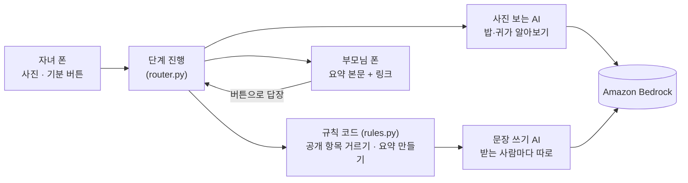

# 밥은 먹었니 🍚

떨어져 사는 자녀가 사진 한 장과 기분 버튼 하나로 엄마·아빠에게 각자 맞는 안부를 보내고, 부모님은 앱 설치 없이 버튼으로 답합니다.

**Demo:** https://d19xe2a33mtra6.cloudfront.net/?feature=bab — 자녀 폰과 엄마 폰이 나란히 보입니다. 「데모 재생」을 누르면 자녀가 사진을 올리는 순간부터 부모님 답장이 돌아오기까지 전 과정이 자동으로 재생됩니다. 사진을 직접 올리면 실제 AI(Amazon Bedrock)가 사진을 보고 알아봅니다. 실제 휴대폰에서는 [자녀 폰 화면](https://d19xe2a33mtra6.cloudfront.net/?feature=bab&view=child)으로 직접 눌러 볼 수 있습니다.

**데모 영상:** https://drive.google.com/drive/folders/1jFWWLKfT282l8f_Uy8kfZYwIqChtO77f?usp=drive_link
---

## 1. 문제 정의

### 대상 사용자
- **자녀:** 부모님과 떨어져 사는 자취 직장인·대학생. 앱을 씁니다
- **부모님:** 앱을 설치하지 않습니다. 카톡·문자로 받고, 링크를 열어 버튼으로 답합니다

### 문제 상황
부모님은 매일 "밥은 먹었니, 집에는 들어갔니"를 묻습니다(**상황**). 자녀는 매일 같은 답을 엄마와 아빠에게 따로 치기가
귀찮아서 답을 미룹니다(**불편**). 답이 없는 동안 부모님은 걱정하고, 자녀는 그 걱정이 부담이 되어 연락을 더 미룹니다.

### 기존 방식과 한계
| 지금 하는 방법 | 한계 |
|---|---|
| 카톡으로 매일 같은 질문과 답을 반복 | 자녀는 매번 타이핑해야 해서 답을 미루고, 부모님은 물어봐야만 알 수 있어 묻는 것 자체가 부담 |
| 가족 위치 공유 앱 | 자녀가 고르지 않은 정보가 자동으로 넘어가 감시처럼 느껴짐. 부모님도 설치·로그인을 해야 함 |
| 엄마·아빠에게 같은 말을 복사해서 보내기 | 엄마는 기분까지 궁금하고 아빠는 귀가만 알면 되는데, 받는 사람에 맞춰 말을 고르는 일이 또 수고가 됨 |

### 근거
- 노인이 떨어져 사는 자녀와 **연락**하는 비율은 64.9% 인데 **왕래**하는 비율은 22.7% 입니다 (2023 노인실태조사 분석, 보건복지포럼 2024-11). 연락은 이미 하고 있으므로, 우리는 그 연락을 쉽고 알차게 만듭니다
- 2024년 1인 가구는 804만 5천 가구로 전체의 36.1% 이고, 그중 48.9% 가 외로움을 느낍니다 (전체 평균 38.2%). 그래서 안부가 한쪽으로만 가지 않도록, 부모님의 "🍚 나도 밥 먹었어"가 자녀에게 돌아오는 양방향으로 만들었습니다
- 중년 부모 247명의 7일 일기 연구에서 96% 가 그 주에 자녀와 연락했고, 절반 넘는 부모가 자녀 걱정 같은 스트레스성 생각을 겪었습니다. 같은 날 즐거운 연락을 하면 그 영향이 줄었습니다 (Fingerman et al., 2016)
- 행동은 동기·능력·계기가 함께 있을 때 일어납니다 (Fogg Behavior Model). 자녀에게 동기는 이미 있으므로 남은 것은 **쉽게 만드는 것**입니다. 그래서 안부 보내기를 사진 첨부와 버튼 누르기로 끝냅니다

출처 URL 과 각 근거를 어디에 적용했는지는 [`docs/ideas/bab-ux-evidence.md`](docs/ideas/bab-ux-evidence.md) 에 정리했습니다 (행동심리·가족관계 연구, 한국 통계, 카카오톡·토스·BeReal·Life360 의 UX 패턴).

### 목표
- 자녀는 **타이핑 없이** 사진과 버튼으로 안부를 끝냅니다
- 부모님은 **묻지 않아도**, 링크를 열지 않아도 메시지 본문만 보고 오늘 안부를 압니다
- 무엇을 알릴지는 **자녀가** 정하고, 받는 사람마다 다른 내용과 말투로 갑니다

---

## 2. 핵심 기능

받는 사람마다 **프로필**이 있습니다. 프로필은 누구에게 어떤 항목을 어떤 말투로 보낼지 미리 정해 둔 설정입니다.
예: 엄마 = 밥·귀가·기분을 다정하게 / 아빠 = 귀가만 짧게.

| 기능 | 해결하는 불편 | 코드 위치 |
|---|---|---|
| AI 가 사진을 보고 밥을 먹었는지, 집에 들어왔는지 알아봄 | 매일 같은 답을 타이핑하는 수고 | `backend/features/bab/service.py` (`run_judge`) |
| 기분은 자녀가 버튼으로 고름 (😊 좋아 · 🙂 괜찮아 · 😪 피곤해 · 😵 바빠 · 🤒 아파 + ✏️ 직접 입력) | AI 가 기분을 잘못 짐작해 틀린 안부가 가는 것 | `backend/features/bab/rules.py` (`normalize_mood`) |
| AI 가 알아본 결과(예: 밥 ✓ 김치찌개 · 귀가 ✓ 21시)를 보여 주고, 자녀가 확인·수정한 뒤 보냄 | 틀린 정보가 부모님께 가는 것 | `rules.py` (`normalize_checks`), `frontend/src/features/bab/index.tsx` |
| 받는 사람 프로필에 따라 보내는 항목과 말투가 달라짐 | 엄마와 아빠가 궁금한 것이 다름. 자녀가 알리고 싶은 범위도 다름 | `rules.py` (`filter_facts`) + `service.py` (`run_compose`), `profiles.json` |
| 사진으로 확인하지 못한 항목은 보내지 않음 | 근거 없는 "밥 잘 먹었어"나 "귀가 확인 안 됨"으로 부모님이 속거나 불안해지는 것 | `rules.py` (`filter_facts`) |
| 메시지 본문에 안부 요약을 그대로 넣음 | 부모님이 링크를 못 누르거나 안 누름 | `rules.py` (`build_summary`, `build_bubble`) |
| 부모님은 미리 정해 둔 버튼 5개로 답장 (❤️ 잘 받았어 · 📞 전화할게 · 🍚 나도 밥 먹었어 · 🏥 병원 다녀왔어 · 🙂 오늘 괜찮아) | 부모님에게 설치와 타이핑이 부담 | `rules.py` (`normalize_pressed`), `frontend/src/features/bab/remote.tsx` |
| 부모님 답장이 자녀 폰에 알림으로 도착 ("엄마도 밥 드셨대요") | 안부가 자녀 → 부모 한 방향으로만 감 | `frontend/src/features/bab/index.tsx` |

### 구조



AI는 **두 곳**에만 씁니다. 사진을 보고 밥·귀가를 알아볼 때, 그리고 받는 사람마다 문장을 쓸 때입니다.
공개 항목 거르기, 요약 만들기, 부모님 버튼 처리는 정해진 규칙(코드)으로 처리하므로 결과가 매번 같습니다.
설계 근거는 [`.kiro/specs/bab/design.md`](.kiro/specs/bab/design.md) 에 있습니다.

## 3. 사용 시나리오

1. 자녀 민지(예시)가 앱을 엽니다. 오늘 안부를 보낼 사람은 엄마와 아빠입니다
2. 점심 사진과 현관 사진 2장을 올리고 "😪 피곤해"를 누릅니다
3. AI 가 사진을 보고 "밥 ✓ 김치찌개 · 귀가 ✓ 21시"로 정리해 보여 줍니다
4. 민지가 결과를 확인합니다. 틀렸으면 눌러서 고칩니다
5. 엄마용(밥·귀가·기분, 다정하게)과 아빠용(귀가만, 짧게) 메시지가 나란히 만들어집니다
6. 부모님 폰에 요약이 담긴 메시지와 링크가 도착합니다. 링크를 열지 않아도 안부를 압니다
7. 엄마가 링크를 열어 ❤️ 와 "🍚 나도 밥 먹었어"를 누릅니다
8. 민지 폰에 "엄마도 밥 드셨대요" 알림이 뜹니다

## 4. 기대 효과

위 시나리오(받는 사람 2명)를 기준으로 계산한 값입니다. 사용자 대상 실측은 아직 하지 않았습니다.

| 항목 | 지금 (카톡으로 직접) | 밥은 먹었니 |
|---|---|---|
| 자녀가 타이핑하는 글자 수 | 약 50자 ("점심 김치찌개 먹었어, 9시에 들어왔어, 좀 피곤해" 약 25자 × 2명) | **0자** |
| 자녀가 하는 일 | 대화방 2개를 열고 각각 답장 | **사진 첨부 + 버튼 4번** (기분 고르기 · AI에게 정리 맡기기 · 확인 · 보내기) |
| 받는 사람별로 말을 바꾸는 수고 | 자녀가 직접 고름 | **0회** (프로필에 따라 자동) |
| 부모님이 설치하는 앱 | 위치 공유 앱이면 1개 + 로그인 | **0개** (카톡·문자 본문으로 받음) |
| 부모님이 안부를 아는 데 필요한 동작 | 먼저 묻고 답을 기다림 | **0번** (본문 요약만 읽음) |
| 부모님이 답장하는 데 필요한 동작 | 타이핑 | **버튼 1번** |
| 보내지 않기로 한 내용이 새는 횟수 | 복사해서 보내면 그대로 감 | **0건** (아빠 메시지에 기분 표현 0건을 자동 테스트와 실제 AI 호출로 확인) |

## 5. 차별점

| | 카톡 직접 답장 | 가족 위치 공유 앱 | **밥은 먹었니** |
|---|---|---|---|
| 자녀의 수고 | 매번 타이핑 | 없음 (자동) | 사진 + 버튼 |
| 누가 공개 범위를 정하나 | 자녀 | 앱 (자동 수집) | **자녀가 고르고, 받는 사람마다 다르게** |
| 부모님 설치 | 없음 | 필요 | **없음** |
| 부모님이 답하는 방법 | 타이핑 | 없음 (보기만) | **버튼 하나** |

- **부모님은 아무것도 설치하지 않습니다.** 카톡·문자 본문만 봐도 안부를 알고, 링크는 사진을 크게 보거나 답할 때만 엽니다
- **감시가 아니라 자녀가 보내는 안부입니다.** 위치를 자동으로 넘기지 않고, 사진으로 확인된 밥·귀가와 자녀가 고른 기분만 갑니다
- **사진은 한 번 올렸는데 엄마용과 아빠용이 다릅니다.** 아빠에게 보내지 않는 기분은 AI에게도 넘기지 않아서, AI가 실수로 말할 수 없습니다
- **AI 는 기분을 짐작하지 않고, 모르는 것은 말하지 않습니다.** 기분은 자녀가 버튼으로 고르고, 사진으로 확인되지 않은 항목은 메시지에서 뺍니다

---

## 6. 설치와 실행

요구 버전: Node 24 이상, Python 3.12 이상, [pnpm](https://pnpm.io), [uv](https://docs.astral.sh/uv/)

```bash
# 1. 의존성 설치 (Python + Node 를 한 번에)
pnpm bootstrap

# 2. 환경변수
cp .env.example .env        # 실제 AI 를 쓰려면 BEDROCK_MODEL_ID 와 AWS 자격증명을 채웁니다

# 3-a. 실행 — AI 호출 없이 미리 준비한 예시 데이터로 전 과정 재생 (AWS 계정 불필요)
pnpm mock                   # http://localhost:5173 → 「데모 재생」

# 3-b. 실행 — 실제 AI(Amazon Bedrock) 호출
pnpm dev
```

백엔드는 8000, 프런트는 5173 포트입니다.

### 화면 고르기 (배포본·로컬 공통)

| 주소 | 보이는 것 |
|---|---|
| `/?feature=bab` | 자녀 폰·엄마 폰 두 대 (발표·녹화용 기본 화면) |
| `/?feature=bab&view=child` | 자녀 폰만 — 실제 휴대폰에서 직접 눌러 볼 때 |
| `/?feature=bab&view=mom&s=<세션>` | 부모님이 메시지 링크로 들어오는 답장 화면. `s` 는 보낼 때 만들어지며, 자녀 폰에서 보내면 메시지 링크에 그대로 들어갑니다 |
| `?showcase=1` 추가 | 발표용 보조 패널. 각 단계에서 AI가 한 일과 규칙 코드가 한 일을 나눠 보여 줍니다 |

## 7. 테스트

```bash
pnpm check                  # 코드 검사 + 백엔드·프런트 자동 테스트 전체
pnpm smoke                  # 예시 데이터로 처음부터 끝까지 막힘없이 진행되는지 확인 (AWS 호출 없음)
pnpm smoke:ui               # 빌드한 뒤 브라우저 화면까지 같은 확인
```

백엔드 자동 테스트 64개와 프런트 화면 테스트 30개가 통과합니다. 주요 테스트는 다음과 같습니다.

| 파일 | 확인하는 것 |
|---|---|
| `tests/test_bab_contract.py` | 기획 문서·예시 데이터·받는 사람 프로필이 서로 맞는지 (진행 단계 순서, 안부 항목과 버튼 목록, AI가 밥·귀가만 알아보는지) |
| `tests/test_bab_rules.py` | 아빠에게 가는 AI 입력에 기분이 없는지, 메시지 본문에 요약이 들어가는지, 부모님은 정해 둔 버튼으로만 답하는지 |
| `tests/test_bab_flow.py` | 엄마용·아빠용 메시지가 서로 다르고, 아빠 메시지에 기분 표현이 없는지 |
| `tests/test_bab_photo_reuse.py` | 자녀가 올린 사진으로 판단하는지, 사진으로 확인하지 못한 항목은 보내지 않는지 |

예시 데이터뿐 아니라 실제 AI(Amazon Bedrock)로도 처음부터 끝까지 돌려서, 아빠 메시지에 기분 표현이 없고 엄마·아빠 메시지가 서로 다르다는 것을 확인했습니다.

---

## Kiro 로 만든 방법

자세한 기록은 [`BUILD_REPORT.md`](BUILD_REPORT.md) 에 있습니다. 어떤 작업을 Kiro 로 했고 어떤 작업을 다른 도구로 했는지도 거기에 그대로 적었습니다.

| Kiro 기능 | 이 프로젝트에서 한 일 | 위치 |
|---|---|---|
| **Steering** | 팀원 3명이 Kiro를 쓸 때마다 자동으로 읽히는 팀 규칙 파일 6개. 그중 제품 규칙(안부 항목은 밥·귀가·기분·한마디 4개만, 기분은 버튼으로, 보내지 않기로 한 항목은 AI에 넘기지 않음)은 항상 읽히고, 프런트·백엔드 규칙은 해당 폴더를 고칠 때만 읽힙니다 | `.kiro/steering/` |
| **Spec** | 제품 규칙을 요구사항 9개와 완료 기준으로 옮기고, 작업 11개마다 담당자(기획·백엔드·프런트)와 완료 기준을 연결했습니다. 설계 단계에서 "엄마용과 아빠용 문장을 같은 대화에서 만들면 엄마에게 쓴 기분이 아빠 문장에 섞인다"는 문제를 구현 전에 찾았습니다. 실제 사진으로 시험하다 "밥 사진이 아닌데도 밥 먹었다고 보내는" 오류를 찾았을 때는, 완료 기준부터 고치고 테스트를 붙였습니다 | `.kiro/specs/bab/` |
| **Custom agents** | 개발용 에이전트 `build` 와, 코드를 고치지 않고 읽기만 하는 리뷰용 에이전트 `review` | `.kiro/agents/` |
| **Hooks** | 에이전트를 시작할 때 현재 변경 상태를 보여 주고, 작업이 끝나면 팀 규칙 위반과 데모가 깨졌는지를 자동으로 검토 | `.kiro/hooks/`, `.kiro/agents/build.json` |
| **Skills** | 코드 리뷰, 발표 슬라이드, 데모 영상 만드는 절차를 묶어 둠 | `.kiro/skills/` |

---

## 팀

- **팀 번호:** team-022
- **팀명:** AAcrew

| 이름 | 역할 |
|---|---|
| 영신 | 기획, spec·통합, 규칙 코드 |
| 채연 | 백엔드, AI 에이전트 |
| 세민 | 프런트엔드, 발표 자료 |
